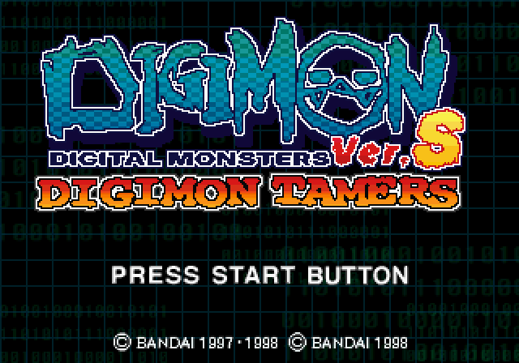
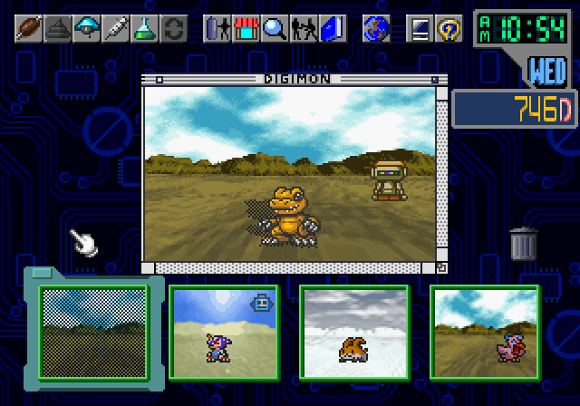
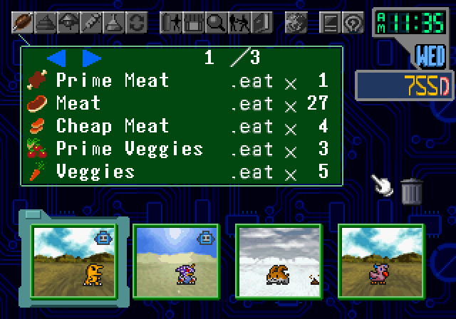
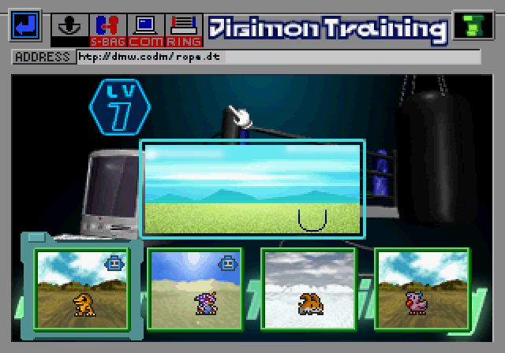
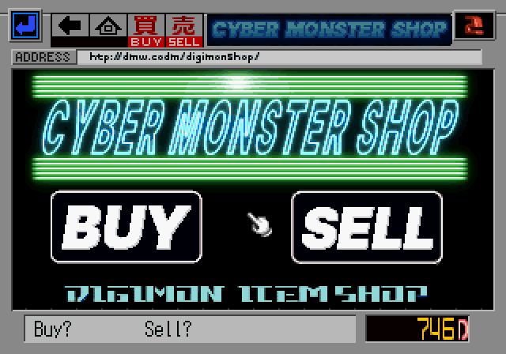
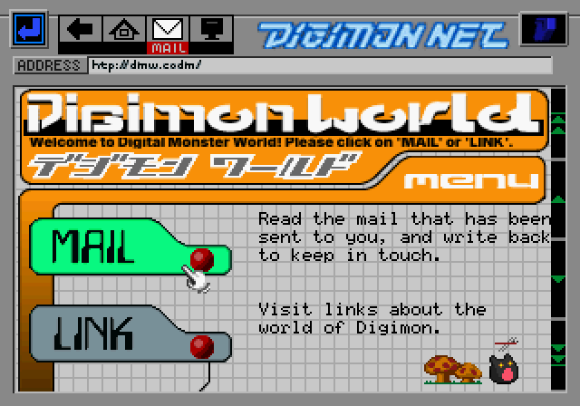
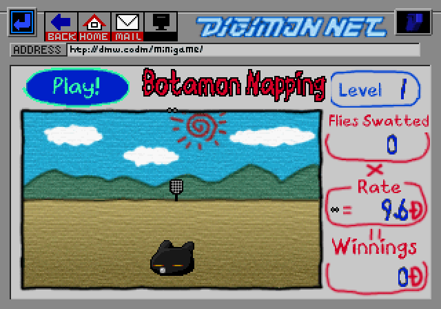

# Digital Monster Ver. S: Digimon Tamers — English Translation

English fan translation patch for **Digital Monster Ver. S: Digimon Tamers**
(デジタルモンスター Ver.S, Sega Saturn, Bandai 1998).

Translation and hacking by **GorillaKenobi**.

**[⬇ Download the latest release](../../releases/latest)** — current version: **v0.9.3** (beta)

  

> [!IMPORTANT]
> - This is an unofficial fan translation, not affiliated with or endorsed by Bandai.
> - It is free, non-profit, and produced with the help of machine learning.
> - It must never be sold. If you paid for it, you were scammed.
> - Please support the official Digimon releases.

## What's translated

Everything you need to read to play:

- Menus, status screens, shop, items and the help system
- All mail, forum posts and lab news
- Hacker battles and their dialogue
- The opening narration and the ending credits
- Title screen logo, minigames and other in-game graphics with text

Some Japanese is intentionally left in place as part of the game's "cyberpunk"
look: the card backs, the CD art, and the Mail/Shop backdrop wallpapers.

## Translation notes

- **Not a 1:1 translation.** Some liberties were taken with dialogue to keep the
  characters' flavor and humor natural in English, so lines won't always match
  the Japanese word for word.
- **Made with machine learning / AI assistance.** The translation was produced with
  AI help and then reviewed and edited by hand. If something reads oddly, please
  [open an issue](../../issues).
- **Japanese terminology.** The patch follows the original Japanese terms rather than
  the English anime dub. For example, the growth stages are Baby, Child, Adult and
  Perfect, not Rookie, Champion and Ultimate.
- **Work in progress.** More graphical tweaks to the UI design are planned for
  future versions.

## Screenshots

  
  

  
  

  
  

## What you need

A BIN/CUE dump of the game that matches [Redump](http://redump.org/).
Only **Track 01** is patched; keep the other tracks and the `.cue` file as they are.

| | |
|---|---|
| Original Track 01 MD5 | `f6f6753a6e6e9c91ce094ed742f5b96e` |
| Original Track 01 size | 25,709,712 bytes |

If your copy is a CHD, ISO+WAV or another format, convert it back to BIN/CUE first.

**No game data is included in this repository or its releases. You need your own copy of the game.**

## How to patch

1. Download the release zip and extract it.
2. Open a BPS patcher, such as [Rom Patcher JS](https://www.marcrobledo.com/RomPatcher.js/)
   (runs in your browser) or [Floating IPS (Flips)](https://github.com/Alcaro/Flips).
3. Choose `Digital Monster Ver. S - Digimon Tamers (Japan) (Track 01).bin` as the ROM
   and `DigimonVerS_EN_v0.9.3 (Track 01).bps` as the patch.
4. Save the result with the same file name as the original Track 01, so the `.cue` still points to it.

| Patched Track 01 (v0.9.3) | |
|---|---|
| MD5 | `ac97205a791b09123a684229410dcc35` |
| CRC32 | `756b302b` |

## Notes

- Start a new game. Saves made with the Japanese version keep the Japanese default Digimon name.
- Known issues:
  - The numbers 0–9 on the name-entry keyboard sit slightly left in their boxes.
  - The status screen is still in Japanese during Hacker battles.

Found a bug or a typo? Please [open an issue](../../issues) with a screenshot and where in the game it appears.

## Font credits

The new text graphics were drawn with these fonts. No font files are distributed.

| Font | Author | License |
|---|---|---|
| Px437 DOS/V re. JPN12, DOS/V re. JPN16, HP 100LX 6x8, Sanyo MBC-775 (2y), Sanyo MBC-55x | VileR, [The Ultimate Oldschool PC Font Pack](https://int10h.org/oldschool-pc-fonts/) | [CC BY-SA 4.0](https://creativecommons.org/licenses/by-sa/4.0/) |
| Inter | Rasmus Andersson, [rsms.me/inter](https://rsms.me/inter/) | SIL Open Font License 1.1 |
| DejaVu Sans Condensed Bold | [DejaVu Fonts project](https://dejavu-fonts.github.io/) | Bitstream Vera license |
| Lazenby Computer (Smooth) | Andrew Young, [Disaster Fonts](https://disasterfonts.co.uk/) | [CC BY-SA 4.0](https://creativecommons.org/licenses/by-sa/4.0/) |
| Crayon Libre | GGBotNet | CC0 1.0 |
| Noto Sans CJK JP | Google and Adobe, [noto-cjk](https://github.com/notofonts/noto-cjk) | SIL Open Font License 1.1 |
| Courier 10 Pitch | Bitstream (contributed to the X Consortium) | X11-style permissive license |

## License

The patch and translation are licensed under
[CC BY-SA 4.0](https://creativecommons.org/licenses/by-sa/4.0/). See [LICENSE](LICENSE).

This covers only the work of this project. *Digital Monster* / *Digimon* and all original
game content are © Bandai / WiZ and are not covered by this license. This project is not
affiliated with or endorsed by Bandai or Sega.
